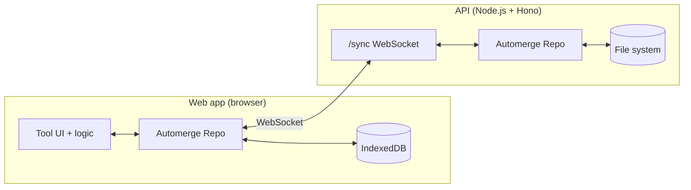

# tools

A small collection of local-first tools for everyday work. The first tool is a
Todo list that keeps working offline and synchronizes through Automerge when an
API server is available.

## Architecture

This repository is a TypeScript monorepo managed with pnpm workspaces. The web
app owns the user interface and a browser-side Automerge repository backed by
IndexedDB. The Node.js API keeps a server-side repository backed by the file
system and exposes the WebSocket sync endpoint.



### Workspace packages

- `apps/web` – SolidJS single-page app built with Vite, Tailwind CSS, and
  DaisyUI.
- `apps/api` – Node.js Hono API with Automerge WebSocket synchronization and
  file-system document storage.
- `packages/shared` – shared Zod schemas and types.
- `packages/toolkit` – the tool contract and helpers for persistent Automerge
  document URLs.
- `tools/todo` – the first tool, a local-first Todo list.

The pnpm workspace includes `apps/*`, `packages/*`, and `tools/*`.

## Requirements and setup

- Node.js 22 or newer
- pnpm 12 or newer

Install dependencies with:

```bash
pnpm install
```

## Development

Start the API and web app together:

```bash
pnpm dev
```

By default:

- Web app: <http://127.0.0.1:5173>
- API: <http://127.0.0.1:8787>
- API document data: `./automerge-repo-data`

The API reads `TOOLS_DATA_DIR` for its Automerge file-system storage location:

```bash
TOOLS_DATA_DIR=/tmp/tools-data pnpm --filter @tools/api dev
```

The Vite development server proxies `/info` and the `/sync` WebSocket to
`http://127.0.0.1:8787` by default. Set `TOOLS_API_URL` when the API is hosted
elsewhere:

```bash
TOOLS_API_URL=http://127.0.0.1:8788 pnpm --filter @tools/web dev
```

## Web routes and API

The web app provides these routes:

- `/` – the tool index.
- `/:toolId` – the page for a tool, such as `/todo`.

The API provides:

- `GET /info` – health/status response: `{ "status": "OK" }`.
- `GET /sync` – Automerge WebSocket synchronization endpoint.

Documents are stored in the browser's IndexedDB and synchronized with the API
when a peer is available. A tool's document can be shared with a `?doc=` URL
parameter.

## Adding a tool

1. Create a package under `tools/<tool-id>` with a SolidJS component and an
   Automerge document type. Follow `tools/todo` as the reference implementation.
   The `tools/*` workspace is included in Tailwind's source scan, so classes in
   future tools are discovered automatically.
2. Add the package's `package.json` and `tsconfig.json`, exporting a tool
   definition with `defineTool` from `@tools/toolkit`.
3. Use `useRepo`, `useDocument`, and `ensureToolDocument` so the tool's document
   is persisted locally and can be shared with a `?doc=` link.
4. Register the exported tool in `apps/web/src/tools.ts`.
5. Use DaisyUI components and keep all document mutations inside the Automerge
   handle's `change` callback.

## Verification

Run the complete verification suite from the repository root:

```bash
pnpm fmt
pnpm lint
pnpm build
pnpm test
```

Install Chromium once if browser tests have not been set up yet:

```bash
pnpm --filter @tools/web exec playwright install chromium
```
